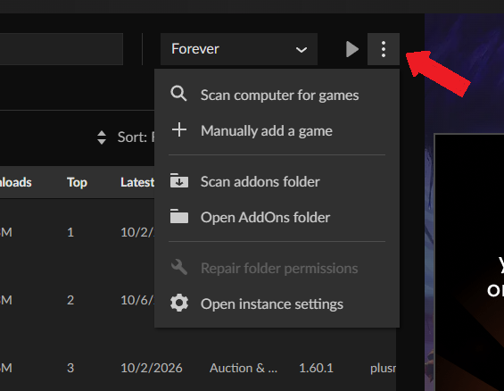
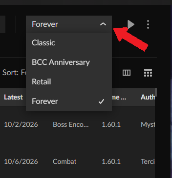
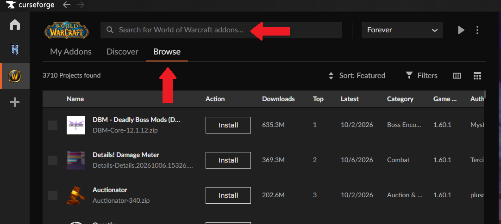

# WoW-Forever-Addons

Blizzard ha implementado los addons mas importantes dentro de Forever por lo que los addons listados a continuación son opcionales para mejorar la calidad de vida y personalizacion de tu UI.

### Interfaz
- [EllesmereUI](https://www.curseforge.com/wow/addons/ellesmereui) *Personalización completa para la UI.*

### Leveling
- [RestedXP](https://www.elitepvpers.com/forum/wow-guides-templates/4792923-zygor-classic-retail-other-addons-updated.html) *1- Tienes que registrarte para poder ver los links 2-Instalas RestedXP en Curseforge. 3- Descargas el .zip. 4- Pegas el archivo descargado en la carpeta Addons y reemplazas todo.*

### Mazmorras/Raids
- [DungeonJournal](https://www.curseforge.com/wow/addons/dungeonjournal) *Información de mazmorras, incluye misiones, ubicaciones, recompensas y botín de los jefes.*
- [Attune](https://www.curseforge.com/wow/addons/attune) *Muestra y sigue los requisitos de attunement y su progreso.*
- [AtlasLootClassic](https://www.curseforge.com/wow/addons/atlaslootclassic-forever-era-fix) *Muestra el botín de mazmorras, raids, recetas y recompensas.*

### QoL
- [Leatrix Plus](https://www.curseforge.com/wow/addons/leatrix-plus) *Añade numerosas mejoras y opciones de calidad de vida a la interfaz.*
- [Leatrix Maps](https://www.curseforge.com/wow/addons/leatrix-maps) *Mejora el mapa y añade información adicional sobre zonas y ubicaciones.*
- [What's Training?](https://www.curseforge.com/wow/addons/whats-training) *Muestra las habilidades que puedes aprender de los instructores.*
- [RareScanner](https://www.curseforge.com/wow/addons/rarescanner) *Detecta y avisa de mobs raros y tesoros cercanos.*
- [Clique](https://www.curseforge.com/wow/addons/clique) *Permite lanzar hechizos sobre unidades mediante mouseover y combinaciones de ratón o teclado.*
- [Naowh Forever](https://www.curseforge.com/wow/addons/naowhforever) *Addon todo en uno que reúne herramientas para consultar equipo BiS, botín de mazmorras, talentos, profesiones, PvP y utilidades como reparación, venta de objetos basura y avisos de combate.*
- [Tamed](https://www.curseforge.com/wow/addons/tamed) *Para cazadores que permite consultar qué habilidades pueden aprender las mascotas domesticables y dónde encontrar las bestias que enseñan nuevos rangos de esas habilidades. Incluye información dentro del juego y marcadores en el mapa para facilitar su búsqueda.*

### Inmersión durante el leveo
- [Social Diary](https://www.curseforge.com/wow/addons/social-diary) *Registra tus encuentros con otros jugadores, creando un diario de aventuras, interacciones y combates PvP.*
- [Spoken](https://www.curseforge.com/wow/addons/spoken) *Añade voces a los diálogos de misiones, conversaciones con NPC, historias de zonas y libros de WoW Forever, haciendo que el mundo sea más inmersivo. Disponible en español y requiere instalar los paquetes de audio correspondientes.*
- [Dialogue UI](https://www.curseforge.com/wow/addons/dialogueui) *Mejora la interfaz de diálogos y misiones de WoW con una presentación más inmersiva, cámara dinámica, textos personalizables, soporte para mando y lectura de diálogos en voz alta.*

---

### 1. Descargar CurseForge
[CurseForge](https://www.curseforge.com/download/app?utm_source=chatgpt.com) Seleccionas la versión Standalone

### 2. Instalar CurseForge
Ejecutas el instalador y sigues los pasos habituales. Una vez instalado, abres CurseForge.

### 3. Seleccionar World of Warcraft
En el caso de que no aparezca puedes seleccionar en la + Scan computer for games o añadir manualmente, por defecto WoW esta en: C:\Program Files (x86)\World of Warcraft

### 4. Instalación de Addons
Si no te encuentra tu carpeta de Addons puedes buscarla automaticamente en Scan addons folder o manualmente en: C:\Program Files (x86)\World of Warcraft\_classic_beta_\Interface\AddOns

Te aseguras que estas en Forever

Dentro de la pestaña Browser puedes buscar los Addons que quieras e instalarlos

Los Addons los tendrás en My Addons donde podrás actualizarlos o eliminarlos.

